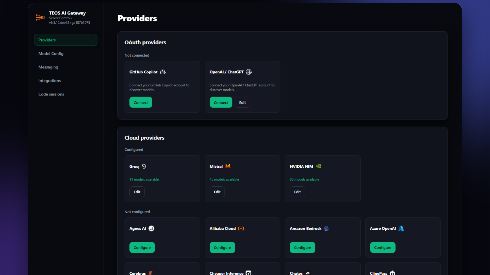

<div align="center">

<h1>
  <picture>
    <source media="(prefers-color-scheme: light)" srcset="assets/teos-ai-gateway-wordmark-light.svg">
    
  </picture>
</h1>

[](LICENSE)
[](https://www.python.org/downloads/)
[](https://github.com/astral-sh/uv)

[Quick Start](#quick-start) · [Providers](#choose-a-provider) · [Clients](#connect-your-client) · [Integrations](#optional-integrations) · [Manage](#manage-your-installation)

</div>

<p align="center">
  <em>Unified access to multiple AI providers — one local endpoint for your coding agents.</em>
</p>

<p align="center">
  <em>TEOS AI Gateway is a modified distribution of
  <a href="https://github.com/Alishahryar1/free-claude-code">Free Claude Code</a> by Ali Khokhar,
  licensed under AGPL-3.0-only. It is an independent project, not affiliated with or endorsed
  by Anthropic or by the Free Claude Code authors. Claude and Claude Code are trademarks of
  Anthropic. See <a href="TEOS_MODIFICATIONS.md">TEOS_MODIFICATIONS.md</a> for the list of modifications.</em>
</p>

## What You Get

- **56 ToS-friendly providers. One catalog.** Mix free, paid, subscription, and local models from one searchable UI without putting your account at risk. TEOS follows each provider's terms and removes integrations if they stop being allowed.
- **11 coding agents. One model catalog.** Run [Claude Code](https://code.claude.com/docs/en/overview), [Codex](https://github.com/openai/codex), [Pi](https://github.com/earendil-works/pi), [OpenCode](https://github.com/anomalyco/opencode), [Cline](https://github.com/cline/cline), [Hermes](https://github.com/NousResearch/hermes-agent), [DeepSeek Harness](https://github.com/deepseek-ai/deepseek-harness), [Grok Build](https://github.com/xai-org/grok-build), [Muse Code](https://research.meta.ai/blog/introducing-muse-code-and-muse-spark-1-2/), [Aider](https://aider.chat/), or [VS Code Chat](https://code.visualstudio.com/) with your TEOS models.
- **Keep coding through provider outages.** After retries are exhausted, TEOS automatically tries your next configured model without making you restart the turn. This works across every client.
- **Up to 90% fewer terminal-output tokens.** Optional [RTK](https://github.com/rtk-ai/rtk) filters common command output, while five TEOS optimizations handle quota probes, command-prefix detection, titles, suggestions, and filepaths without calling a provider.
- **Native Code sessions in your browser.** Choose a folder and run Codex in the browser with real-time and background support. Freely switch providers/models in the same session. Support for switching harnesses in the same session coming soon!
- **Terminal, desktop, IDE, or phone.** Work through native launchers, [VS Code](https://code.visualstudio.com/), [Codex App](https://learn.chatgpt.com/docs/app), [JetBrains](https://www.jetbrains.com/), [Discord](https://discord.com/), or [Telegram](https://telegram.org/).
- **Voice notes in. Code out.** Talk to your agent using local [Whisper](https://github.com/openai/whisper) or [NVIDIA NIM](https://docs.nvidia.com/nim/speech/latest/asr/deploy-asr-models/whisper.html) transcription.
- **Agent capabilities stay intact.** Stream responses, use tools, preserve native interleaved thinking for maximum performance, send images, and route [Fable](https://www.anthropic.com/claude/fable), [Opus](https://www.anthropic.com/claude/opus), [Sonnet](https://www.anthropic.com/claude/sonnet), and [Haiku](https://www.anthropic.com/claude/haiku) independently with compatible models.

Free-tier availability and limits are controlled by each provider and may change.

<div align="center">
  
  <p><em>Claude Code running with TEOS.</em></p>
</div>

<div align="center">
  
  <p><em>A native Codex session in TEOS's browser UI.</em></p>
</div>

## Quick Start

<a id="install"></a>

### 1. Install

TEOS AI Gateway ships as an **offline Windows bundle**: the app is installed from the
wheel inside the bundle, never fetched from a package feed (the installer does download
uv and Python once). Get the ready-to-run bundle, unzip
`TEOS-AI-Gateway-Windows-<version>.zip`, then run:

```powershell
powershell -ExecutionPolicy Bypass -File .\Install-TEOS-AI-Gateway.ps1
```

> **Where do I get the bundle?** The pre-built, ready-to-run Windows bundle is the paid
> product (one-time): <https://aamsmith3.gumroad.com/l/teos-ai-gateway>. The complete
> source of this build is included with every purchase (inside the bundle as `source/`)
> and remains available under **AGPL-3.0-only**.

The installer installs the wheel, adds the `teos`, `teos-server` and `teos-doctor`
commands (plus one `teos-<agent>` command per supported coding agent), creates
Start-menu and desktop shortcuts, and replaces the automatic updater with a no-op so
an upstream release can never replace this build.

Developers can build from the corresponding source included in the bundle:

```bash
uv tool install .
```

## FREE TIER INCLUDED — Start coding for $0

No paid API key needed to start:

- **NVIDIA NIM FREE API** — 80+ models included (nemotron, Llama, DeepSeek V3, Qwen, Mistral and more). Get your free key at [build.nvidia.com](https://build.nvidia.com) in 30 seconds, paste in TEOS, and you're ready.
- **Local models FREE forever** — Ollama, LM Studio, llama.cpp. Run Llama, CodeLlama, Mistral fully offline, no key at all.
- **Other free tiers** — OpenRouter FREE models, Groq FREE tier, Gemini FREE tier — all from one UI.

> TEOS AI Gateway itself is a one-time purchase ($39 for the first 50 copies, then $99). Using free tiers from providers is subject to each provider's limits and terms.

### 2. Start TEOS

#### Windows

Open **TEOS AI Gateway** from your desktop or Start menu.

#### macOS

Open **TEOS AI Gateway** from your desktop or Applications folder.

#### Linux

Run:

```bash
teos-server
```

TEOS opens the Admin UI after starting. On Windows and macOS, use the tray or
menu-bar icon to open Admin, restart, or quit. When using `teos-server`, keep its
terminal open.

<a id="nvidia-nim-provider"></a>

### 3. Configure NVIDIA NIM

1. Create an API key at [build.nvidia.com/settings/api-keys](https://build.nvidia.com/settings/api-keys).
2. Open the Admin UI URL from the server log.
3. Paste the key into `NVIDIA_NIM_API_KEY`.
4. Leave `MODEL` on the default `nvidia_nim/nvidia/nemotron-3-super-120b-a12b`, or search the model dropdown and select another model.
5. Click **Apply**.

To protect the local proxy with a bearer token, enable **Proxy Authentication**
in Admin.

<div align="center">
  
</div>

### 4. Free Tier Quick Start (Recommended)

- **NVIDIA NIM** — Get a free API key at [build.nvidia.com/settings/api-keys](https://build.nvidia.com/settings/api-keys), paste it in Admin → Apply. 80+ models included.
- **Local models** — Enable Ollama/LM Studio in Admin (or just have them running). No key needed.
- **Other free tiers** — OpenRouter (free models), Groq (free tier), Gemini (free tier) all work from the same UI.

### 5. Run Your Coding Agent

Claude Code:

```bash
teos-claude
```

Codex:

```bash
teos-codex
```

Pi:

```bash
teos-pi
```

OpenCode 2:

```bash
teos-opencode
```

To upgrade from OpenCode 1, close OpenCode and rerun the TEOS installer with
OpenCode selected. For npm or other package-manager installations, follow
[OpenCode's migration instructions](https://opencode.ai/v2/docs/migrate-v1/)
first. For npm v1, run `npm uninstall -g opencode-ai`, then rerun the TEOS installer.

RTK integration is temporarily unavailable for OpenCode 2. RTK continues to work
with the other supported agents.

Use `teos-opencode` for coding and sessions. Use plain `opencode` for commands
such as upgrades, service management, ACP, and MCP setup.

Cline:

```bash
teos-cline
```

Hermes:

```bash
teos-hermes
```

DeepSeek Harness Web:

```bash
teos-dsh
```

Grok Build:

```bash
teos-grok
```

Muse Code:

```bash
teos-muse
```

Aider:

```bash
teos-aider
```

<a id="model-picker"></a>

<div align="center">
  
  <p><em>Select a TEOS model from Claude Code's native <code>/model</code> picker.</em></p>
</div>

## Choose A Provider

1. Open a provider link below for its key, models, or setup instructions.
2. In the Admin UI, configure the listed setting. For OpenAI / ChatGPT
   subscription access, use **Providers → OAuth providers** instead.
3. Search the `MODEL` dropdown and select a model. If the provider cannot list
   models, enter `<provider-id>/<exact-provider-model-id>` manually.
4. Click **Apply**.

Optional: add an ordered **Fallback Models** list under **Model Config**. It
applies to every connected client. A failed request may reach and consume usage
from more than one provider before succeeding.

For another API endpoint, open **Providers → Custom providers → Add provider**. Enter its API base URL, optional key, and API format. Leave **Model IDs** empty to discover models automatically, or enter one upstream model ID per line. Save, then select a model in **Model Config**.

<details>
<summary><strong>Provider catalog</strong></summary>

| Provider | Admin UI setting | Example `MODEL` |
| --- | --- | --- |
| [NVIDIA NIM](https://build.nvidia.com/settings/api-keys) | `NVIDIA_NIM_API_KEY` | `nvidia_nim/nvidia/nemotron-3-super-120b-a12b` |
| [OpenRouter](https://openrouter.ai/keys) | `OPENROUTER_API_KEY` | `open_router/openrouter/free` |
| [Groq](https://console.groq.com/keys) | `GROQ_API_KEY` | `groq/llama-3.3-70b-versatile` |
| [ClinePass](https://docs.cline.bot/getting-started/clinepass) | `CLINE_API_KEY` | `cline_pass/cline-pass/kimi-k3` |
| [OpenAI / ChatGPT](https://learn.chatgpt.com/docs/auth) | Connect ChatGPT in the Admin UI | `openai/<model-id>` |
| [OpenAI API](https://platform.openai.com/api-keys) | `OPENAI_API_KEY` | `openai_api/gpt-5.6-sol` |
| [GitHub Copilot](https://docs.github.com/en/copilot/how-tos/copilot-sdk/auth/authenticate) | Connect GitHub Copilot in the Admin UI | `github_copilot/<model-id>` |
| [xAI (Grok)](https://console.x.ai/team/default/api-keys) | `XAI_API_KEY` | `xai/grok-4.5` |
| [Alibaba Cloud](https://www.alibabacloud.com/help/en/model-studio/get-api-key) | `ALIBABA_CLOUD_API_KEY` | `alibaba_cloud/<model-id>` |
| [QwenCloud Token Plan](https://home.qwencloud.com/api-keys) | `QWENCLOUD_API_KEY` | `qwencloud/qwen3.7-plus` |
| [QwenCloud Coding Plan](https://home.qwencloud.com/api-keys) | `QWENCLOUD_CODING_API_KEY` | `qwencloud_coding/qwen3.7-plus` |
| [Together AI](https://api.together.ai/settings/api-keys) | `TOGETHER_API_KEY` | `together/zai-org/GLM-5.2` |
| [DeepInfra](https://deepinfra.com/dash/api_keys) | `DEEPINFRA_API_KEY` | `deepinfra/deepseek-ai/DeepSeek-V4-Flash` |
| [SiliconFlow](https://cloud.siliconflow.com/account/ak) | `SILICONFLOW_API_KEY` | `siliconflow/Qwen/Qwen3-32B` |
| [Nebius Token Factory](https://tokenfactory.nebius.com/project/api-keys) | `NEBIUS_API_KEY` | `nebius/Qwen/Qwen3-30B-A3B` |
| [Chutes](https://chutes.ai/docs/getting-started/authentication) | `CHUTES_API_KEY` | `chutes/Qwen/Qwen3-32B-TEE` |
| [Featherless AI](https://featherless.ai/account/api-keys) | `FEATHERLESS_API_KEY` | `featherless/Qwen/Qwen3-32B` |
| [Agnes AI](https://agnes-ai.com/) | `AGNES_API_KEY` | `agnes/agnes-2.0-flash` |
| [ZenMux](https://zenmux.ai/platform/pay-as-you-go) | `ZENMUX_API_KEY` | `zenmux/deepseek/deepseek-v4-flash-free` |
| [W&B Inference](https://wandb.ai/settings) | `WANDB_API_KEY` | `wandb/openai/gpt-oss-20b` |
| [Azure OpenAI](https://learn.microsoft.com/azure/foundry/openai/how-to/chatgpt) | `AZURE_OPENAI_API_KEY` and `AZURE_OPENAI_BASE_URL` | `azure_openai/<deployment-name>` |
| [Google AI Studio (Gemini)](https://aistudio.google.com/apikey) | `GEMINI_API_KEY` | `gemini/models/gemini-3.1-flash-lite` |
| [Google Vertex AI](https://cloud.google.com/vertex-ai/generative-ai/docs/start/openai) | `VERTEX_PROJECT_ID` + ADC | `vertex/google/gemini-3.5-flash` |
| [DeepSeek](https://platform.deepseek.com/api_keys) | `DEEPSEEK_API_KEY` | `deepseek/deepseek-chat` |
| [Mistral La Plateforme](https://console.mistral.ai/) | `MISTRAL_API_KEY` | `mistral/devstral-small-latest` |
| [Mistral Codestral](https://console.mistral.ai/) | `CODESTRAL_API_KEY` | `mistral_codestral/codestral-latest` |
| [OpenCode Zen](https://opencode.ai/auth) | `OPENCODE_API_KEY` | `opencode_zen/gpt-5.3-codex` |
| [OpenCode Go](https://opencode.ai/auth) | `OPENCODE_API_KEY` | `opencode_go/minimax-m2.7` |
| [Vercel AI Gateway](https://vercel.com/docs/ai-gateway/models-and-providers) | `AI_GATEWAY_API_KEY` | `vercel/openai/gpt-5.5` |
| [Amazon Bedrock](https://console.aws.amazon.com/bedrock/) | `AWS_BEARER_TOKEN_BEDROCK` | `bedrock/openai.gpt-oss-120b` |
| [Hugging Face Inference Providers](https://huggingface.co/settings/tokens) | `HUGGINGFACE_API_KEY` | `huggingface/Qwen/Qwen3-Coder-480B-A35B-Instruct:fastest` |
| [Cohere](https://dashboard.cohere.com/api-keys) | `COHERE_API_KEY` | `cohere/command-a-plus-05-2026` |
| [Wafer](https://wafer.ai/) | `WAFER_API_KEY` | `wafer/DeepSeek-V4-Pro` |
| [Kimi API](https://platform.moonshot.ai/console/api-keys) | `KIMI_API_KEY` | `kimi/kimi-k2.5` |
| [Kimi Code](https://www.kimi.com/code/console) | `KIMI_CODE_API_KEY` | `kimi_code/k3` |
| [MiniMax](https://platform.minimax.io/user-center/basic-information/interface-key) | `MINIMAX_API_KEY` | `minimax/MiniMax-M3` |
| [Cerebras Inference](https://cloud.cerebras.ai/) | `CEREBRAS_API_KEY` | `cerebras/gpt-oss-120b` |
| [SambaNova](https://cloud.sambanova.ai/apis) | `SAMBANOVA_API_KEY` | `sambanova/Meta-Llama-3.3-70B-Instruct` |
| [Kilo.ai](https://kilo.ai) | `KILO_API_KEY` | `kilo/kilo-auto/free` |
| [Fireworks AI](https://fireworks.ai/account/api-keys) | `FIREWORKS_API_KEY` | `fireworks/accounts/fireworks/models/llama-v3p3-70b-instruct` |
| [Novita AI](https://novita.ai/settings/key-management) | `NOVITA_API_KEY` | `novita/deepseek/deepseek-v4-flash-0731` |
| [Cloudflare Workers AI](https://developers.cloudflare.com/workers-ai/) | `CLOUDFLARE_API_TOKEN` and `CLOUDFLARE_ACCOUNT_ID` | `cloudflare/@cf/moonshotai/kimi-k2.6` |
| [Z.ai Coding Plan](https://z.ai/manage-apikey/apikey-list) | `ZAI_API_KEY` | `zai/glm-5.2` |
| [Z.ai API (pay as you go)](https://z.ai/manage-apikey/apikey-list) | `ZAI_API_KEY` | `zai_api/glm-4.7-flash` |
| [TokenRouter](https://www.tokenrouter.com/) | `TOKENROUTER_API_KEY` | `tokenrouter/moonshotai/kimi-k3-free` |
| [NaraRoute](https://router.bynara.id/) | `NARAROUTE_API_KEY` | `nararoute/kimi-k3-free` |
| [Poolside AI](https://platform.poolside.ai/) | `POOLSIDE_API_KEY` | `poolside/poolside/laguna-s-2.1` |
| [LLM7.io](https://dash.llm7.io/) | `LLM7_API_KEY` | `llm7/default` |
| [Scaleway](https://console.scaleway.com/iam/api-keys) | `SCW_SECRET_KEY` | `scaleway/deepseek/deepseek-v4-flash` |
| [Lightning AI](https://lightning.ai/) | `LIGHTNING_API_KEY` | `lightning/lightning-ai/Qwen3.8-27B` |
| [Experiential Labs](https://platform.experientiallabs.ai/) | `EXPLABS_API_KEY` | `experiential/union-alpha` |
| [Cheaper Inference](https://cheaperinference.com/signup) | `CHEAPER_INFERENCE_API_KEY` | `cheaperinference/gpt-5.4-mini` |
| [OrcaRouter](https://www.orcarouter.ai/) | `ORCAROUTER_API_KEY` | `orcarouter/deepseek/deepseek-v4-flash-free` |
| [Ollama Cloud](https://ollama.com/settings/keys) | `OLLAMA_API_KEY` | `ollama_cloud/qwen3-coder:480b` |
| [LM Studio](https://lmstudio.ai/) | `LM_STUDIO_BASE_URL` | `lmstudio/<model-id>` |
| [llama.cpp](https://github.com/ggml-org/llama.cpp) | `LLAMACPP_BASE_URL` | `llamacpp/<model-id>` |
| [Ollama](https://ollama.com/) | `OLLAMA_BASE_URL` | `ollama/<model-tag>` |

</details>

<details>
<summary><strong>Provider-specific setup</strong></summary>

- OpenAI / ChatGPT uses your ChatGPT subscription rather than an API key. Connect from
  **Providers → OAuth providers → OpenAI / ChatGPT → Connect** in the Admin UI
  and finish signing in through your browser. Restart an already-running agent after connecting.
- OpenAI API uses a separate Platform API key. Enter it under
  **Providers → Cloud providers → OpenAI API → Configure**. The model list may
  include IDs that cannot handle coding requests. Choose a text-generation model.
- GitHub Copilot uses your signed-in GitHub account and subscription. Install
  [Copilot CLI 1.0.83](https://github.com/github/copilot-cli/releases/tag/v1.0.83)
  on PATH, then choose **Providers → OAuth providers → GitHub Copilot → Connect**.
  Finish signing in, then select a `github_copilot/<model-id>` from the model picker.
  Available models and quotas depend on your subscription and organization policies.
  Restart an already-running agent after connecting.
- Azure OpenAI uses the deployment names from your resource. Set
  `AZURE_OPENAI_BASE_URL` to its complete v1 endpoint, such as
  `https://YOUR-RESOURCE-NAME.openai.azure.com/openai/v1/`, and select a
  deployment that supports Chat Completions. Enter the deployment name as a
  custom model slug if it does not appear in the model dropdown.
- Mistral Codestral uses a separate key from Mistral La Plateforme.
- Kimi Code subscription keys use `kimi_code/`. Kimi API credit keys use
  `kimi/`. Kimi Code plans are for personal interactive coding-agent use under
  [Kimi's community guidelines](https://www.kimi.com/code/docs/en/kimi-code/community-guidelines.html).
- Alibaba Cloud uses a Model Studio pay-as-you-go key and defaults to Singapore.
  For another region or workspace, set `ALIBABA_CLOUD_BASE_URL` to its
  [OpenAI-compatible endpoint](https://www.alibabacloud.com/help/en/model-studio/base-url)
  ending in `/compatible-mode/v1`. The key and endpoint must use the same region.
- QwenCloud Coding Plan keys use `qwencloud_coding/`. QwenCloud Token Plan keys
  use `qwencloud/`. The keys and endpoints are not interchangeable. Coding Plan
  is for local, personal, interactive coding-agent use under the
  [Coding Plan terms](https://www.alibabacloud.com/help/en/model-studio/coding-plan).
- OpenCode Zen and OpenCode Go share `OPENCODE_API_KEY` but use the explicit
  `opencode_zen/` and `opencode_go/` model prefixes.
- For Amazon Bedrock, set `BEDROCK_BASE_URL` to the URL for the same region as
  the API key and select one of the listed models.
- Vertex AI uses Google Application Default Credentials instead of an API key.
  Locally, run `gcloud auth application-default login` once. Service-account
  files and attached service accounts also work. Set `VERTEX_PROJECT_ID`, and
  optionally change `VERTEX_LOCATION` from its `global` default.
- Cloudflare requires both its API token and account ID.
- For Ollama Cloud, use the exact model IDs shown in the model picker. Local
  Ollama uses the separate `ollama/` prefix.
- Prefer tool-capable models for coding agents. Local models also need enough context for the agent's system prompt and tool definitions.

</details>

<details>
<summary><strong>Local provider setup</strong></summary>

### LM Studio

Start LM Studio's local server, load a tool-capable model, and use the model identifier shown by LM Studio with the `lmstudio/` prefix. The default URL is `http://localhost:1234/v1`.

### llama.cpp

Start `llama-server` with its OpenAI-compatible Chat Completions API and enough context for the model. Use the local model ID with the `llamacpp/` prefix. `LLAMACPP_BASE_URL` defaults to `http://localhost:8080/v1`.

### Ollama

```bash
ollama pull llama3.1
ollama serve
```

Use the tag shown by `ollama list` with the `ollama/` prefix. `OLLAMA_BASE_URL` defaults to `http://localhost:11434`.

</details>

<details>
<summary><strong>Optional model-tier routing</strong></summary>

`MODEL` is the fallback for every request. Select a model for `MODEL_FABLE`, `MODEL_OPUS`, `MODEL_SONNET`, or `MODEL_HAIKU` to override an individual Claude Code tier. Select **None** to use `MODEL`.

</details>

<details>
<summary><strong>Reasoning control</strong></summary>

Open **Admin UI → Model Config → Reasoning** and select the behavior you want.

| Selection | Behavior |
| --- | --- |
| **From client** (default) | Use the effort sent by your coding agent. If none is sent, keep the provider default. |
| **Off** | Request reasoning to be disabled. |
| **Low**, **Medium**, **High**, **X-High**, or **Max** | Override the client with the selected reasoning level. |
| **Inherit** (Fable, Opus, Sonnet, and Haiku only) | Use the root Reasoning selection. |

Providers that do not support a selected control retain their own behavior.

</details>

<a id="connect-your-client"></a>

## Connect Your Client

For editor and app integrations, install the client, start TEOS, then open
**Admin UI → Integrations** and click **Connect** on its card.

- **Claude Code in VS Code**: Install the [Claude Code extension](https://marketplace.visualstudio.com/items?itemName=anthropic.claude-code).
- **VS Code Chat**: Install the latest [VS Code](https://code.visualstudio.com/), connect, and select a TEOS model in its built-in Chat model picker.
- **Claude Desktop**: Install [Claude Desktop](https://claude.ai/download). Fully quit it before connecting or disconnecting, then reopen it. Disconnect returns to normal Claude sign-in.
- **Codex in VS Code and App**: Install the [Codex extension](https://marketplace.visualstudio.com/items?itemName=openai.chatgpt) or Codex App.
- **Claude Code in JetBrains ACP**: Install Claude Agent in JetBrains AI Assistant and start it once, then click **Connect** in TEOS. Reopen the IDE, select **Claude Code (TEOS)**, and start a new chat. After JetBrains updates the agent, restart TEOS before starting a new chat. Requires a local IDE in its standard installation locations.

Reload VS Code or restart the app/IDE after connecting. In Codex and Claude Desktop, select a TEOS
model from the model picker. Reload or restart the client when TEOS reports updated settings. Use
**Disconnect** on the same card to remove the integration.

Run TEOS on the same computer and in the same user environment as the client you
are configuring.

<a id="optional-integrations"></a>

## Optional Integrations

Configure integrations from **Admin UI → Messaging**, then click **Apply**.

<details>
<summary><strong>Discord bot</strong></summary>

1. Create a bot in the [Discord Developer Portal](https://discord.com/developers/applications).
2. Enable **Message Content Intent** and invite it with read, send,
   message-history, and **Manage Messages** permissions so `/clear` can remove
   user prompts.
3. Set **Messaging Platform** to **discord**.
4. Enter **Discord Bot Token**, **Allowed Discord Channels**, and an absolute **Allowed Directory**.
5. Apply the settings and restart the server if requested.

</details>

<details>
<summary><strong>Telegram bot</strong></summary>

1. Create a bot with [@BotFather](https://t.me/BotFather).
2. Get your numeric user ID from [@userinfobot](https://t.me/userinfobot).
   In groups, grant the bot permission to delete messages.
3. Set **Messaging Platform** to **telegram**.
4. Enter **Telegram Bot Token**, **Allowed Telegram User ID**, and an absolute **Allowed Directory**.
5. Apply the settings and restart the server if requested.

</details>

### Messaging commands

| Usage | Behavior |
| --- | --- |
| `/stats` | Show session state. |
| Standalone `/stop` | Cancel all work. |
| Reply with `/stop` | Cancel only the selected request while other queued requests continue. |
| Standalone `/clear` | Clear all TEOS conversations and their messages in this chat. |
| Reply with `/clear` | Delete the selected message and the chain of replies to it. Keep other conversations. |

<details>
<summary><strong>Voice notes</strong></summary>

NVIDIA NIM transcription support is included in every installation. In **Admin UI → Messaging → Voice**, enable voice notes, select `nvidia_nim`, and choose a supported model. Configure your **NVIDIA NIM API key** on the Providers page.

For local Whisper on CPU or CUDA, reinstall the tool from the **wheel in the bundle's
`dist` folder**, with the local voice extra:

```powershell
uv tool install --force ".\dist\free_claude_code-<version>-py3-none-any.whl[voice_local]"
```

Add `--torch-backend cu130` for CUDA 13.0.

Do **not** install the bare `free-claude-code` name from PyPI: that is the upstream
project, and it would replace this build with one that exposes the old `fcc-*` commands.

After installing local support, restart `teos-server`. In **Admin UI → Messaging → Voice**, enable voice notes, select `cpu` or `cuda`, and choose the Whisper model. Local gated models need `HUGGINGFACE_API_KEY`.

</details>

## Manage Your Installation

Run `teos-server --version` to check the installed version without starting TEOS.

### Update

TEOS AI Gateway is distributed as an **offline bundle**. To update, stop all running
TEOS commands, then run the installer from a newer bundle:

```powershell
powershell -ExecutionPolicy Bypass -File .\Install-TEOS-AI-Gateway.ps1
```

`teos-update` is intentionally a no-op stub in this build, so the upstream Free Claude
Code auto-updater can never replace it.

### Uninstall

Stop every running TEOS command, then remove the tool and its data:

```powershell
uv tool uninstall free-claude-code
Remove-Item -Recurse -Force "$env:USERPROFILE\.fcc"
```

Then delete the **TEOS AI Gateway** Desktop and Start-menu shortcuts if you created them.

**Keeps**

- uv and Python
- Your coding agents and RTK

## Project Links

For a problem after installation, run the command below and paste its output into your bug report. It also copies the JSON to your clipboard when available.

```bash
teos-doctor
```

- Report a bug or request a feature: email `AYMAN@TEOSEGYPT.COM` (include the `teos-doctor` output)
- [Modification notice](TEOS_MODIFICATIONS.md)
- [Contributing guide](CONTRIBUTING.md)

## License

GNU Affero General Public License version 3 only (`AGPL-3.0-only`). See [LICENSE](LICENSE) for details.
